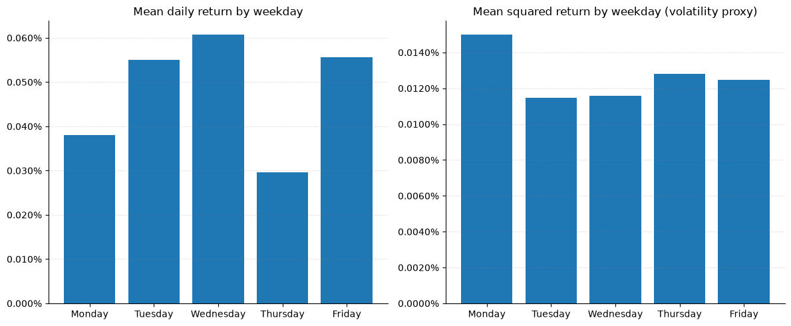
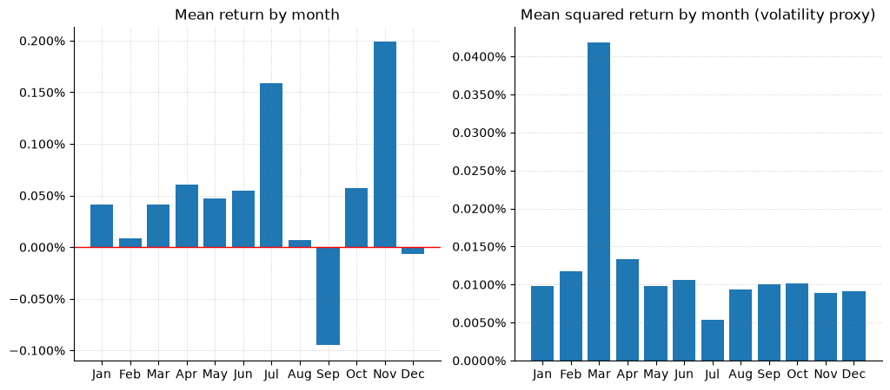
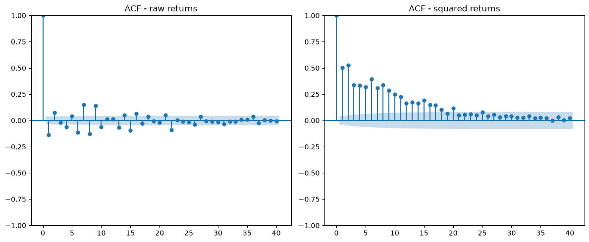
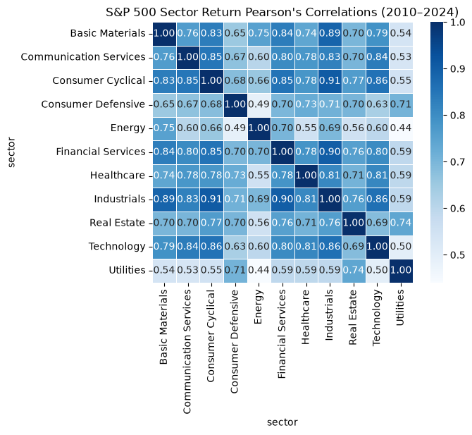
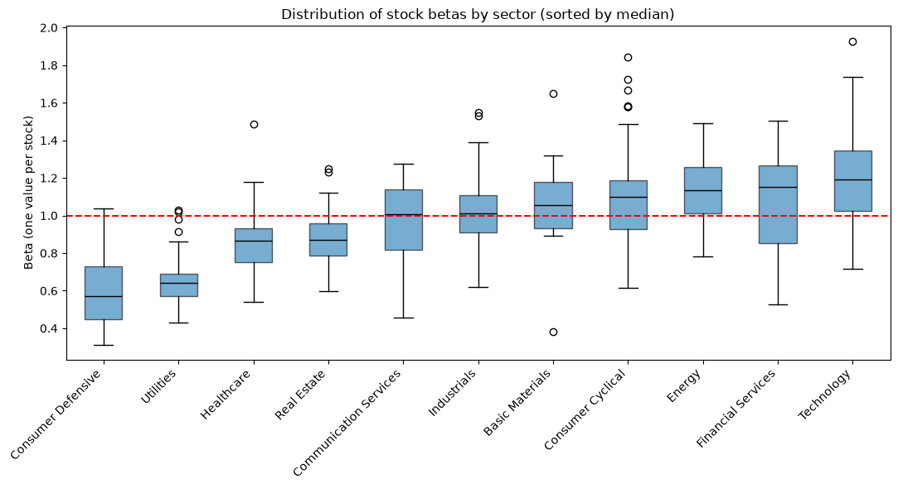
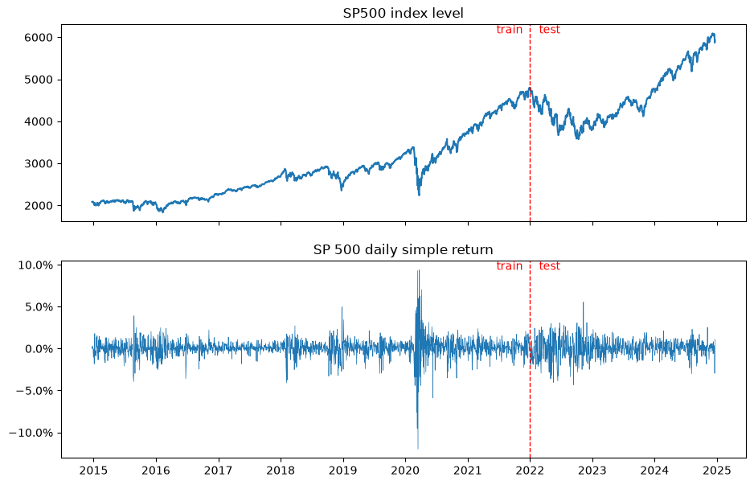

# S&P500 Market and Portfolio Analysis

### Intro <!-- omit from toc -->

This is an end-to-end analysis project of the S&P 500 stocks from 2010 to 2024, built with **PostgreSQL** and **Python** independently and in parallel, to showcase versatility across both tools.

The project examines return, risk, diversification, market exposure and time-series behavior. It asks which stocks and sectors performed best and with what risk, whether weekday or monthly patterns exist and are statistically meaningful, how strongly sectors move together, how sensitive individual stocks are to the overall market, whether sector differences are statistically significant and whether returns or volatility can be forecast better than simple benchmarks (zero, yesterday, historical mean). 

The workflow of the data covers:
- Loading;
- Exploration;
- Cleaning;
- Transformation;
- Descriptive analysis;
- Statistical testing;
- Regression;
- Forecasting and out-of-sample evaluation;

This is a market and portfolio analysis, **not a stock picking strategy or price prediction project**.

Forecasting appears only at the end and it is evaluated against simple baselines rather than presented as a tool for predicting future stock prices.

Reproducibility note

This is not fully reproducible out of the box. All Python notebooks and SQL scripts of what was done are included but with my own local paths defined inside each file. Those paths should be changed to match each own's environment if there's intention to run them.

### TL;DR <!-- omit from toc -->

- **Data:** daily prices for 502 current S&P 500 constituents (2010-01-04 to 2024-12-20) plus the S&P 500 index (2014-12-22 to 2024-12-20).
- **Performance and risk:** Technology had the best risk-adjusted record (return 23% a year, volatility 22.4%, naive Sharpe 1.03). Energy had the worst (volatility 30%, naive Sharpe 0.54, maximum drawdown −71.5%). Consumer Defensive was the calmest (volatility 13.7%, maximum drawdown −24.2%). Daily returns have very fat tails in every sector. 
- **Seasonality:** no weekday or month effect in average returns (p = 0.99 and p = 0.16). Volatility does differ by month, but much of that is due to March 2020: remove that single month and the difference is no longer significant (p = 0.081).
- **Diversification:** sectors move together. The average correlation between two sectors' daily returns is 0.71 (0.62 with a rank-based method). Utilities and Energy are the most distinct, being the least correlated pair at 0.44, still positively correlated so sector diversification helps only moderately.
- **Market exposure:** the average stock has a beta of 0.99. Sector averages run from 0.60 (Consumer Defensive) to 1.21 (Technology) and the differences are statistically significant. The market explains only about a third of a typical stock's daily variance.
- **Forecasting:** daily returns are not predictable with these methods, as nothing beat the best naive baseline. Volatility was found to be persistent with last month's volatility being a strong forecast of next month's (tied with a simple regression).

### Table of contents <!-- omit from toc -->

- [S\&P500 Market and Portfolio Analysis](#sp500-market-and-portfolio-analysis)
    - [About the data](#about-the-data)
    - [The questions and what was found](#the-questions-and-what-was-found)
    - [Data cleaning](#data-cleaning)
    - [Approach](#approach)
    - [Findings](#findings)
      - [1. Performance and risk (Phase 5)](#1-performance-and-risk-phase-5)
      - [2. Seasonality (Phase 6)](#2-seasonality-phase-6)
      - [3. Do sectors move together? (Phase 7.1)](#3-do-sectors-move-together-phase-71)
      - [4. Market exposure: beta (Phase 7.2)](#4-market-exposure-beta-phase-72)
      - [5. Are the sector differences real? (Phase 7.3)](#5-are-the-sector-differences-real-phase-73)
      - [6. Forecasting (Phase 8)](#6-forecasting-phase-8)
    - [What this analysis supports](#what-this-analysis-supports)
    - [Methodology notes](#methodology-notes)
    - [Limitations](#limitations)
    - [Skills and Tools](#skills-and-tools)
  

### About the data

Source: S&P 500 Stocks (daily updated) - Kaggle, by andrewmvd  
https://www.kaggle.com/datasets/andrewmvd/sp-500-stocks

Version used: 1022.  
The subsequent version 1023 (the most recent at the time of writing) contained extensive missing OHLCV data (67%) - checked via Kaggle's own column stats view and by checking AAPL directly (had zero valid adj_close rows). Therefore, this project deliberately uses version 1022.

Content: three files, that will be place in the raw data folder of this project (will not be committed to this repo):

- `sp500_companies.csv` - one row per ticker: sector, industry, market cap, etc.
- `sp500_index.csv` - daily S&P 500 index level (benchmark for regression).
- `sp500_stocks.csv` - daily OHLCV per ticker.

These files will not be committed to the repository.

### The questions and what was found

| # | Question | Short answer | Where |
|---|---|---|---|
| 1 | Which stocks and sectors had the best and worst returns and volatility? | Technology best and Energy worst on risk-adjusted terms. Single stocks are far riskier than sector portfolios. | [Phase 5](python/05_descriptive_stats.ipynb) |
| 2 | Are there real day-of-week or month patterns? | No in average returns. The month-volatility signal is March 2020 alone. | [Phase 6](python/06_seasonality.ipynb) |
| 3 | How correlated are sectors with each other? | Highly: mean 0.71, 95% of sector pairs above 0.5. | [Phase 7](python/07_correlation_CAPM.ipynb) |
| 4 | How sensitive is each stock to the market? | Beta from 0.31 to 1.93. Defensive sectors low, Technology high. | [Phase 7](python/07_correlation_CAPM.ipynb) |
| 5 | Are sector differences real or noise? | Real for beta and for average stock return (both p < 0.001), as an overall test. No info about which pairs differ. | [Phase 7](python/07_correlation_CAPM.ipynb) |
| 6 | Can returns or volatility be predicted better than a naive baseline? | Returns: no. Volatility: last month's level is the benchmark (regression only ties it). | [Phase 8](python/08_forecasting.ipynb) |

### Data cleaning

**Summary**:
| Step | What was found | What was done |
|---|---|---|
| Range | 1,891,536 stock rows, 502 tickers, 3,768 dates each. Index: 2,517 days. | 502 tickers because three companies have two share classes (GOOG/GOOGL, FOX/FOXA, NWS/NWSA). |
| Duplicates and joins | 0 duplicate rows, 0 symbols missing from either table. | Nothing to fix. |
| Missing values | 100,475 rows (5.31%) have every price and volume empty, never just some of them. All sit before the stock's first real price (none are in the middle or after). This is consistent with pre-listing padding, although the dataset has no listing-date field to confirm it. | Removed. Clean table: 1,791,061 rows. |
| Zero-volume, flat-price days | 1,406 rows (0.07%), 97.5% of them from one ticker (AMCR). | Kept and flagged with a no_trading column. |
| Inconsistent prices | One row (HUBB, 2021-05-05) with a low above the open. The same values appear on Yahoo Finance, so it comes from upstream. | Kept (negligible). |
| Extreme prices | The highest adjusted close (9,924) is NVR, a real high-priced stock. | Kept. |   

**Transformation:** 
- simple and log daily returns from adjusted close (split and dividend adjusted);
- cumulative return;
- 20 and 50-day moving averages;
- 21-day rolling volatility;
- calendar fields. 

Rolling windows are empty until a full window of values.

### Approach

Two parallel tracks (SQL and Python), one folder each and with matching number prefixes.

- SQL: PostgreSQL (window functions, CTEs, CORR, REGR)
- Python: pandas, scipy, statsmodels, matplotlib. Python track reads the CSV files directly and does not use the database.

Some column names differ between tables, though the two tracks mimic each other. 
Statistical inference and forecasting are handled only in Python.

| Phase | Topic | SQL | Python |
|---|---|---|---|
| 1 | Loading | [01_Loading.sql](sql/01_Loading.sql) | [01_loading](python/01_loading.ipynb) |
| 2 | Exploration | [02_exploration.sql](sql/02_exploration.sql) | [02_exploration](python/02_exploration.ipynb) |
| 3 | Cleaning | [03_cleaning.sql](sql/03_cleaning.sql) | [03_cleaning](python/03_cleaning.ipynb) |
| 4 | Transformation | [04_transformation.sql](sql/04_transformation.sql) | [04_transformation](python/04_transformation.ipynb) |
| 5 | Performance and risk | [05_descriptive_stats.sql](sql/05_descriptive_stats.sql) | [05_descriptive_stats](python/05_descriptive_stats.ipynb) |
| 6 | Seasonality | [06_seasonality.sql](sql/06_seasonality.sql) | [06_seasonality](python/06_seasonality.ipynb) |
| 7 | Correlation, CAPM, tests | [07_correlation_capm.sql](sql/07_correlation_capm.sql) | [07_correlation_CAPM](python/07_correlation_CAPM.ipynb) |
| 8 | Forecasting | (Python only) | [08_forecasting](python/08_forecasting.ipynb) |

### Findings

#### 1. Performance and risk (Phase 5)

Each sector's daily return is the average of its stocks' returns that day (equal weight). 

`Sector metrics (equal weighted stocks):`
| Sector | Annual return (mean x 252) | Annual volatility | Sharpe (risk-free = 0) | Compound annual return | Max drawdown |
|---|---:|---:|---:|---:|---:|
| Technology | 23.0% | 22.4% | 1.03 | 22.8% | −34.4% |
| Healthcare | 17.3% | 17.4% | 1.00 | 17.1% | −29.5% |
| Consumer Cyclical | 20.7% | 21.6% | 0.96 | 20.1% | −48.7% |
| Industrials | 19.3% | 20.3% | 0.95 | 18.9% | −40.6% |
| Communication Services | 18.0% | 19.4% | 0.93 | 17.5% | −37.4% |
| Consumer Defensive | 12.8% | 13.7% | 0.93 | 12.5% | −24.2% |
| Financial Services | 17.3% | 21.7% | 0.80 | 16.1% | −43.5% |
| Utilities | 13.1% | 17.8% | 0.74 | 12.2% | −37.1% |
| Real Estate | 14.1% | 20.8% | 0.68 | 12.6% | −41.8% |
| Basic Materials | 14.3% | 22.7% | 0.63 | 12.5% | −41.5% |
| Energy | 16.1% | 30.0% | 0.54 | 12.3% | −71.5% |

 
 

`Overall stocks stats (all 502):`
| Metric | Count | Mean | Std | Min | 25% | 50% | 75% | Max |
|----------|------:|-----:|----:|----:|----:|----:|----:|----:|
| annualized_mean_return (%) | 502.0 | 18.10 | 12.32 | -135.07 | 12.79 | 16.73 | 21.80 | 132.58 |
| annualized_volatility (%) | 502.0 | 30.77 | 9.06 | 16.71 | 24.78 | 28.63 | 34.79 | 90.30 |
| annualized_compound_return (%) | 502.0 | 14.59 | 14.13 | -82.68 | 9.09 | 13.32 | 18.27 | 234.45 |
| max_drawdown (%) | 502.0 | -53.64 | 15.70 | -96.47 | -63.59 | -51.29 | -43.02 | -13.43 |
| sharpe_ratio_naive | 502.0 | 0.60 | 0.26 | -1.50 | 0.46 | 0.60 | 0.74 | 2.74 |
| skewness | 502.0 | -0.03 | 0.90 | -6.37 | -0.28 | -0.03 | 0.18 | 11.35 |
| excess_kurtosis | 502.0 | 15.13 | 23.88 | 0.17 | 7.63 | 10.66 | 15.69 | 395.97 |

*note: min and max values are exaggerated by short history stocks.*
 
 

- **Large fluctuations reduce compound growth relative to the arithmetic average return:** Energy sector presents a good average return (16.1%) but it compounds only to 12.3% because of its large swings (highest volatility).
- **Diversification shows up in the numbers:** The median single stock has an annualized volatility of 28.6%, higher than every sector except Energy (30%). The median stock's worst drawdown is -51%.
- **Extremes at stock level:** Highest total return AVGO (1743%), NVDA (316%), TSLA (263%). Weakest return APA (-74%), WBA (-59%), MOS (-53%). There are stocks with short history (low amount of days) that can produce extreme annualized figures, so rankings should be read together with the number of observations.
- **Fat tails:** The excess kurtosis of pooled stock-level daily returns within each sector (cross sectional) runs from 9.3 (Basic Materials) to 92.7 (Utilities). For reference, a normal distribution has 0 excess kurtosis. Even the lowest value means heavy tails, therefore, extreme days are far more common, so averages and standard deviations understate tail risk.

#### 2. Seasonality (Phase 6)

This section is focussed on the S&P500 index as this provides a clean and a single real time series and is the actual market. This will not include a per-sector or per-stock analysis. 

The bar charts show visible gaps, but with 12 months or 5 weekdays there will always be a best and a worst by chance, so each was tested to see whether those could be just noise.

The metrics are mean return and volatility, so each needs its own appropriate test.

For mean return (outcome/dependent variable is numerical), the goal is to check if it differs by weekday and by month (predictors/independent variables are both categorical with more than two categories) making ANOVA a good choice, but since I don't know if the variances are equal, I'll assume they are not and therefore use the Welch's version.

For volatility (how spread out returns are), the goal is to check whether the variability differs by weekday and by month. The test is Brown–Forsythe, which compares group variances using each return’s absolute distance from its group’s median. The median is used instead of the mean because daily returns include a few genuinely extreme days (crashes and/or rebounds) that would distort a mean-centred version (Levene's test).

Both tests assume that each day’s return is independent of the other days. The autocorrelation plot below is how I checked that assumption.

Returns themselves are almost uncorrelated, with only small, irregular links to their own past (about −0.14 at lag 1). So the mean tests are only mildly affected.

Squared returns are strongly and persistently autocorrelated: big moves tend to follow big moves (volatility clustering). Days are therefore not independent in terms of how large their moves are. This matters for Brown–Forsythe, which works on how far each return is from its group’s median but considers related days as if they were independent information, so its p-values can be underestimated and therefore should be read as approximate.

| Test | Question | Result |
|---|---|---|
| Welch's ANOVA | Does the mean return differ by weekday? | F = 0.07, p = 0.99, no |
| Welch's ANOVA | Does the mean return differ by month? | F = 1.42, p = 0.16, no |
| Brown–Forsythe | Does volatility differ by weekday? | F = 0.22, p = 0.92, no |
| Brown–Forsythe | Does volatility differ by month? | F = 6.95, p < 0.001, yes |
| Brown–Forsythe, **without March 2020** | Does volatility still differ by month? | p = 0.081, **no** |

- November (+0.20% a day) and September (−0.10%) stand out in the chart, but the tests say these gaps are consistent with chance.
- March looks like the most volatile month (2.05% daily standard deviation versus 0.72% for July). That result is largely driven by **March 2020**: its daily standard deviation was 5.9%, against 0.5% to 1.5% in every other March. So this is a one-off event, not a seasonal pattern.
- **Autocorrelation:** raw returns show only small, irregular links to their own past (about −0.14 at lag 1). *Squared* returns are strongly and persistently autocorrelated. In other words, the direction of a move is hard to predict from the past, but big moves tend to follow big moves (**volatility clustering**). This motivates Phase 8.

#### 3. Do sectors move together? (Phase 7.1)

This section is meant to measure the correlation of the returns between sectors, to understand if there's any relationship.

The metric used will be the returns, never the prices. Prices are cumulative and presumed less stable (mean changes constantly with trends), whilst returns measure the percentage move around a stable baseline mean.

Pearson correlation is the chosen method, to see whether each pair of sectors move up and down together in a linear way. Sector simple returns are quantitative and continuous variables, making that method appropriate. The only limitation is that Pearson's can be susceptible to outliers, so the Spearman's correlation (rank based) will also be used just as a safety and corroboration check (robustness).

- Mean correlation between two different sectors: 0.71 (Pearson excluding the diagonal). 104 of the 110 ordered off-diagonal pairs are above 0.5.
- Most correlated: Consumer Cyclical - Industrials (0.91), Financial Services - Industrials (0.90) and Basica Materials - Industrials (0.87).
- Least correlated: Energy - Utilities (0.44), Consumer Defensive - Energy (0.49) and Technology - Utilities (0.50).
- Robustness: a rank-based check (Spearman) is lower, with a mean of 0.62. Dropping March 2020 (outlier) lowers the Pearson mean only to 0.68, which explains about a third of the gap. The rest was not investigated. One plausible reason is that Pearson gives more weight to large moves. Under both measures, sectors co-move substantially.

#### 4. Market exposure: beta (Phase 7.2)

This is intended to understand if and how the market influences the stock's movement. Market and stocks' returns will be paired by date.

The capital asset pricing model (CAPM) will be built, but the simplified one where the risk free rate is assumed to be zero. So:

`stock return = alpha + beta x market return + error`  
>.Alpha is the intercept, the portion of return that CAPM cannot explain through market exposure alone.  
>.Beta is the slope, the stock's average move when the market moves 1%.

With the market return and the stock return for a particular day, the goal is to determine the slope (beta) and the constant (alpha) in order to build the line that minimizes the distances (least squared residuals). 

For the summaries, a minimum threshold of 252 observations (equivalent to 1 trading year) was applied to avoid short lived stocks distorting the sector averages.

Sector summary:
| Sector | Stocks | Mean Beta | Median Beta | Mean R² |
|----------|-------:|----------:|------------:|---------:|
| Basic Materials | 22 | 1.058 | 1.053 | 0.345 |
| Communication Services | 22 | 0.955 | 1.005 | 0.301 |
| Consumer Cyclical | 54 | 1.104 | 1.100 | 0.317 |
| Consumer Defensive | 37 | 0.595 | 0.570 | 0.196 |
| Energy | 22 | 1.143 | 1.133 | 0.245 |
| Financial Services | 67 | 1.081 | 1.154 | 0.436 |
| Healthcare | 61 | 0.860 | 0.865 | 0.278 |
| Industrials | 69 | 1.018 | 1.011 | 0.388 |
| Real Estate | 31 | 0.885 | 0.868 | 0.313 |
| Technology | 82 | 1.211 | 1.190 | 0.399 |
| Utilities | 31 | 0.667 | 0.640 | 0.220 |

- Overall stock mean beta 0.99 and median 0.99, which is expected since the market is roughly the average stock.
- Stocks with the highest betas: PLTR (1.93), CZR (1.85), NVDA(1.74), ON (1.73) and NCLH (1.72).
- Stocks with the lowest betas: CPB (0.31), CLX (0.34), K (0.35), SJM (0.35) and GIS (0.36).
- R squared is modest (about 0.33 on average): most of the typical stock's daily movement is specific to the company, not the market.  

#### 5. Are the sector differences real? (Phase 7.3)

The tables and the boxplot show that sector averages differ in market sensitivity (beta) and in return. This section tests whether those gaps are real or could be explained by how much individual stocks vary within each sector.

For that, Welch’s ANOVA was used with one observation per stock (498 stocks with at least 252 days) and the sector as the group, to assess beta (Q1) and annualized return (Q2).

| Question | Result |
|---|---|
| Do mean betas differ across sectors? | F = 41.7, p << 0.001, YES (sector averages of stock betas 0.60 to 1.21) |
| Do mean annualized stock returns differ across sectors? | F = 11.8, p << 0.001, YES (sector averages of each stock’s annualized return 8.9% to 24.0%) |

This says that **at least one sector differs**. It does not identify which pairs differ. The groups are small (22 to 82 stocks) and stocks share market shocks, so the p-values are approximate.

#### 6. Forecasting (Phase 8)

In this phase, I will use the data and information gathered in phase 6 (seasonality). That phase told what kinds of temporal structure seem to exist and that there was some autocorrelation:

- Raw daily returns: only a small negative correlation (yesterday's return has a weak link to today's).
- Squared returns (the proxy for volatility): strong, slowly fading autocorrelation. Big movement days tend to be followed by more big movement days (volatility clustering).

Now phase 8 asks whether those structures and correlations are actually useful for predictions, more precisely, if the historical structure of the data improves forecasts on data the model has never seen, compared with a naive guess.  

For this, the focus was on:

- Daily return: find tomorrow's SP500 return.
- Volatility: How much the SP500 will move over the next 21 trading days.

Important rules:
- Only the SP500 index series is used (cleanest time series). No stocks nor sectors.
- The time order is never broken (models only ever see the past data).
- The goal of the model is to beat a simple baseline.
- This is a forecasting accuracy exercise, not a trading strategy.

**A "stationarity" assessment was performed (ADF)**, as time-series forecasting models work best when the statistical properties of the data remain stable over time, allowing a model to learn patterns from the past that may still be useful in the future. Choosing which modeling approach is appropriate also depends on this data property.

- **Returns, not prices:** The index level is not stationary (ADF p = 0.99), while daily returns are (p < 0.01). Models need a stable series.
- **Time-split and refitting:** The first training date contains every records till 2021-12-31, but the model keeps being refitted every day on all earlier data.
- **Baselines first:** a model must beat the *best* baseline, not just zero.

Having confirmed which metric is more adequate to be used, the forecasting came next, where I used the mean absolute error (MAE) and the root mean squared error (RMSE) to measure the model's efficiency.

**Daily return** (model: AR(1) - predict today's return from yesterday's):

| Method | MAE | RMSE | MAE vs zero | RMSE vs zero |
|---|---:|---:|---:|---:|
| Zero (predict 0%) | 0.813% | 1.103% | reference | reference |
| Historical mean | 0.812% | 1.103% | +0.05% | +0.02% |
| Yesterday's return | 1.165% | 1.546% | -43.32% | -40.1% |
| AR(1) | 0.836% | 1.122% | -2.84% | -1.7% |

*Note: errors are in daily-return units*

No method beat the baseline (zero and historical mean have essentially the efficiency). AR(1) kept finding a stable, modest negative link between yesterday and today (about −0.16), consistent with Phase 6, but a relationship that weak does not turn into better forecasts.

**21-day volatility** (lagged volatility regression that uses realized volatility over the previous 21 trading days to predict realized volatility over the following 21 trading days). Training only uses examples whose 21-day target had already finished by the forecast date, so no future information leaks in.

| Method | MAE | RMSE | MAE vs 21-trailing | RMSE vs 21-trailing |
|---|---:|---:|---:|---:|
| 21-trailing | 0.242% | 0.320% | reference | reference |
| Long-run | 0.349% | 0.437% | -44.20% | -36.68% |
| Regression | 0.243% | 0.317% | -0.65% | +0.83% |

Recent volatility is a much better guide than the long-run average. The regression is essentially tied with simply carrying volatility forward: it is better on RMSE by 0.8% and worse on MAE by 0.7%. These gaps are too small to call and no significance test was run.

---

### What this analysis supports

*This is analysis, not investment advice.*

1. **Do not count on sector diversification alone.** Sectors share most of their movement (mean correlation 0.71). The combinations that actually diversify are Utilities, Energy and Consumer Defensive against the rest, as they are the least correlated with the others.
2. **Use beta to size market exposure, knowing it is only a historical average.** Mixing Technology (beta about 1.2) with Utilities or Consumer Defensive (about 0.6) gives different market sensitivities. Betas have wide ranges within a sector and a low R², so they describe a stock's average behaviour, not a guarantee.
3. **Do not build a strategy on calendar effects.** Weekday and month return differences are indistinguishable from noise and the March "volatility effect" is one historical event.
4. **Manage risk rather than predict returns.** Daily returns were not predictable here, but volatility is persistent, so recent volatility is a sensible input for sizing risk.
5. **Read return rankings with caution.** They are specific to this sample (see limitations). Energy shows that more risk did not mean more reward: it had the highest volatility (30.0%) and the deepest drawdown (−71.5%) but only the 7th-highest average return of 11 sectors.

---

### Methodology notes

- **Returns:** simple returns from adjusted close. Rolling volatility on stocks uses log returns. Annualization uses 252 trading days (x252 for means, xSQR(252) for volatility).
- **Standard deviation:** `STDDEV` (sample, n−1) in SQL and `std` (ddof=1) in pandas for the headline numbers; the population version is also stored (`pop_std_return`). Skewness and kurtosis use the population (uncorrected) formulas in both tracks so they match; kurtosis is *excess* kurtosis (normal = 0).
- **Sharpe usage and why the risk-free rate is 0:** the dataset has no risk-free rate and adding an external series (for example short‑term U.S. Treasury instruments) was left out to keep the project self-contained and the metric identical for every stock and sector. The result is a "naive" Sharpe: annual mean return ÷ annual volatility. Read it as return per unit of risk, not as a textbook Sharpe. In absolute terms it overstates the textbook value. Because the subtracted rate would be divided by each asset's own volatility, rankings could also shift somewhat, with low-volatility assets losing the most. Sourcing a risk-free series could be a future improvement.
- **Why the pooled sector table has no compound return:** `sector_stock_return_distribution` pools every stock-day of a sector into one "bag" of returns. Compounding needs an ordered path (day 1, then day 2 and so on) and the bag is a mix of different stocks, not a portfolio, so "what $1 invested here would have grown to" has no meaning. The bag supports distribution statistics (mean, spread, skewness, kurtosis). Path-based figures (compound return, drawdown) and the Sharpe ratio live in the equal-weighted sector series, which is a real daily portfolio return.

**What each performance metric is for**

| Metric | What it is | Why it is here |
|---|---|---|
| Annualized mean return | Mean daily return x252: "if the average day repeated for a full year". | Puts stocks and sectors on one familiar scale and is the numerator of the Sharpe ratio. It is an arithmetic average, so it ignores compounding. |
| Annualized volatility | Daily standard deviation xSQR(252). | The standard risk measure in finance and the denominator of the Sharpe ratio. Means grow with time (x252), but volatility grows with the square root of time (xSQR(252)) when daily returns are roughly independent. |
| Sharpe ratio (naive) | Annualized mean ÷ annualized volatility, risk-free rate taken as 0. | Return per unit of risk. It is the main tool for the risk-adjusted ranking of stocks and sectors. |
| Compound annual return | The constant yearly growth rate that reproduces the total cumulative return: (1 + total return)^(252 / days) − 1. | What an investor would actually have compounded, and a fair way to compare stocks with different history lengths. It is lower than the arithmetic annual return when volatility is high (Energy: 16.1% against 12.3%). |
| Maximum drawdown | The largest fall from a previous peak to a later low. | The worst loss someone holding through the period would have lived through. |
- **CAPM:** a simplified market model with a risk-free rate of 0. Beta is used to measure market sensitivity, not to estimate expected returns. A minimum of 252 observations per stock is required for sector summaries and tests.
- **Window:** index-based work (Phase 7.2, 7.3, 8) is restricted to 2014-12-23 to 2024-12-20, because the index file starts in December 2014.
- **Equal-weighted sector series:** each day's sector return is the plain average of the sector's stocks that traded that day.

### Limitations

- **Survivorship bias.** The company list contains today's constituents. Stocks that left the index (including failures) are missing, which flatters returns and rankings.
- **One historical period.** 2010–2024 was largely a strong bull market and includes the 2020 crash. Results may not hold elsewhere.
- **Simplified models.** More flexible models (such as GARCH) were left out of scope, so stating that a simple regression adds nothing does not mean no model can do better.
  - CAPM is a single-factor model with a zero risk-free rate.
  - Volatility model is a plain regression. 
- **Approximate tests.** Groups are small, returns are fat-tailed and volatility clusters, so p-values and confidence intervals are approximations.
- **Independence.** The weekday and month tests assume that one day’s return is independent of the next. Returns are nearly uncorrelated, but volatility clusters, so the volatility tests (Brown–Forsythe) treat strongly related days as independent and their p-values are probably too small, which matters most for significant results (the month-volatility result was already shown to come from March 2020 alone).
- **Forecast evaluation.** A single 2022–2024 test period with overlapping 21-day windows (neighbouring errors are related).
- **Index was the only thing used for forecasting.** Nothing here says the same holds for individual stocks. 

---

### Skills and Tools
**Skills shown:** 
- SQL: PostgreSQL, window functions, CTEs, statistical aggregates.
- Python: pandas, statsmodels, scipy, matplotlib/seaborn, descriptive and inferential statistics, regression, time-series evaluation.

**Tools used:**
- Dbeaver.
- VScode.

**Analytical skills:**
- Data cleaning.
- Exploratory analysis.
- Hypothesis testing.
- Regression.
- Time-series analysis.
- Forecasting.
- Data validation

